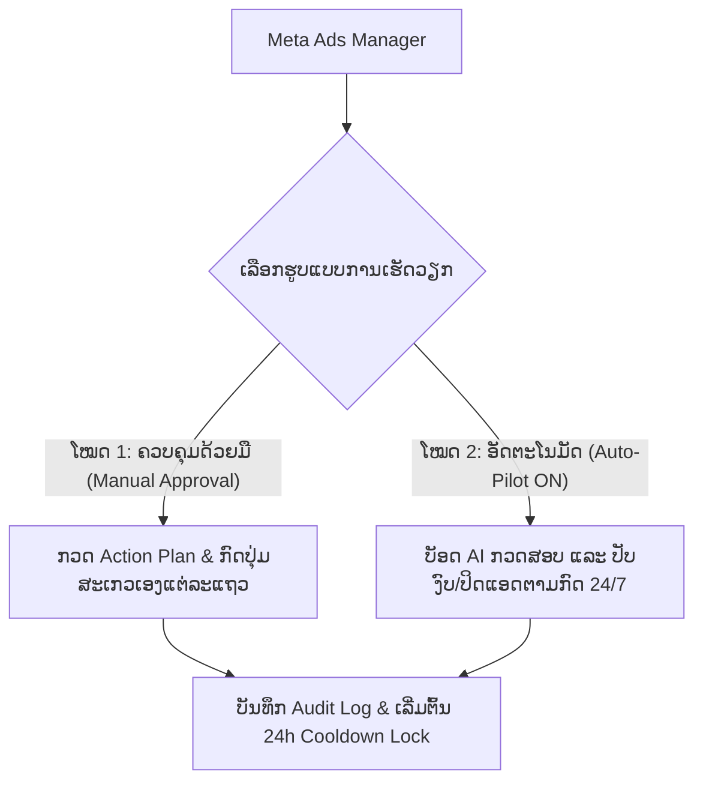
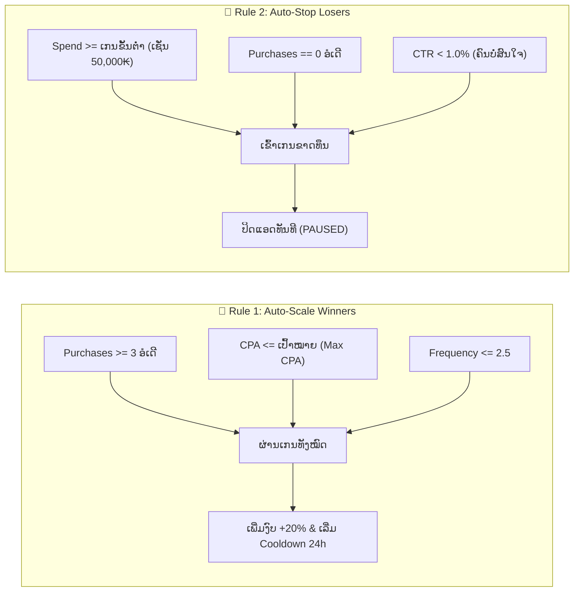
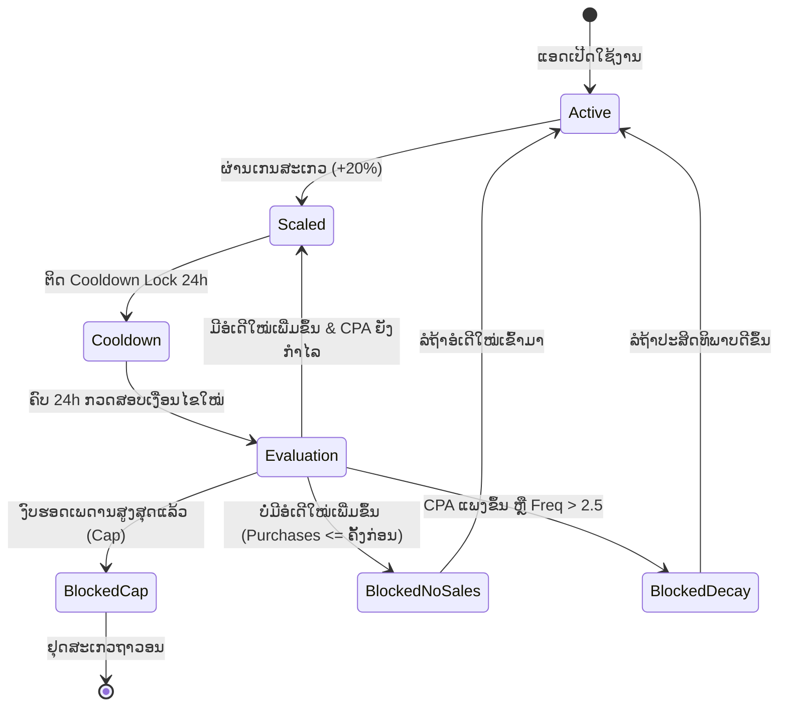

# ຄູ່ມືການໃຊ້ງານລະບົບ Meta Ads Auto-Pilot & Scaling Engine
**ຄູ່ມືມາດຕະຖານການບໍລິຫານຈັດການ ແລະ ສະເກວໂຄສະນາອັດຕະໂນມັດ (Standard Operating Procedure - SOP)**

---

## 📑 ສາລະບານ (Table of Contents)
1. [ພາບລວມຂອງລະບົບ (System Overview)](#1-ພາບລວມຂອງລະບົບ-system-overview)
2. [ມາດຕະຖານສາກົນ: ເປັນຫຍັງຕ້ອງ 20% ແລະ Cooldown 24–48h?](#2-ມາດຕະຖານສາກົນ-ເປັນຫຍັງຕ້ອງ-20-ແລະ-cooldown-2448h)
3. [ໂຄງສ້າງລະດັບໂຄສະນາ: CBO vs ABO vs Creative Ad](#3-ໂຄງສ້າງລະດັບໂຄສະນາ-cbo-vs-abo-vs-creative-ad)
4. [ກົດລະບຽບອັດຕະໂນມັດ 2 ຂໍ້ຫຼັກ (Core Automation Rules)](#4-ກົດລະບຽບອັດຕະໂນມັດ-2-ຂໍ້ຫຼັກ-core-automation-rules)
5. [ກົນໄກຄວາມປອດໄພ 3 ຊັ້ນ ປ້ອງກັນງົບເກີນຄວບຄຸມ (3-Layer Circuit Breakers)](#5-ກົນໄກຄວາມປອດໄພ-3-ຊັ້ນ-ປ້ອງກັນງົບເກີນຄວບຄຸມ-3-layer-circuit-breakers)
6. [ຂັ້ນຕອນການໃຊ້ງານຕົວຈິງ (Step-by-Step Guide)](#6-ຂັ້ນຕອນການໃຊ້ງານຕົວຈິງ-step-by-step-guide)
7. [ຄຳຖາມທີ່ພົບເລື້ອຍ (FAQ & Troubleshooting)](#7-ຄຳຖາມທີ່ພົບເລື້ອຍ-faq--troubleshooting)

---

## 1. ພາບລວມຂອງລະບົບ (System Overview)

ລະບົບ **Meta Ads Controller** ຖືກອອກແບບມາພາຍໃຕ້ສະຖາປັດຕະຍະກຳ **Dual-System (2 ລະບົບໃນໂຕດຽວ)** ເພື່ອໃຫ້ຜູ້ຍິງແອດມີອິດສະຫຼະໃນການຕັດສິນໃຈສູງສຸດ:

### ຈຸດເດັ່ນຂອງລະບົບ:
- **Scales Winners (+20%):** ອັດງົບເພີ່ມໃຫ້ແອດທີ່ຂາຍດີ ມີກຳໄລ.
- **Stops Losers (Stop-Loss):** ປິດແອດທີ່ກິນເງິນລ້າໆ ແຕ່ບໍ່ເກີດຍອດຊື້ ແລະ CTR ຕ່ຳ.
- **100% Parameter Customizable:** ປັບແຕ່ງທຸກເງື່ອນໄຂ (CPA, ອໍເດີ, ເປີເຊັນ, ງົບສູງສຸດ) ໄດ້ຕາມໃຈຜູ້ໃຊ້.
- **Multi-Currency Ready:** ຮອງຮັບທັງເງິນກີບ (LAK ຫຼັກໝື່ນ) ແລະ ເງິນໂດລາ (USD ທົດສະນິຍົມ).

---

## 2. ມາດຕະຖານສາກົນ: ເປັນຫຍັງຕ້ອງ 20% ແລະ Cooldown 24–48h?

> [!NOTE]
> **ສູດນີ້ແມ່ນມາດຕະຖານລະດັບໂລກ (Global Industry Standard) ທີ່ສາຍ Media Buyer ແລະ ເຄື່ອງມືຊັ້ນນຳ (Meta Native Rules, Revealbot, Madgicx, TheOptimizer) ນຳໃຊ້ຮ່ວມກັນ.**

1. **ການປົກປ້ອງສະຖານະຮຽນຮູ້ຂອງ Meta (Learning Phase Protection):**
   - ເມື່ອເຮົາປັບງົບປະມານໂຄສະນາ **ເກີນ 20% ຫາ 30% ໃນບາດດຽວ**, AI ຂອງ Facebook ຈະຖືວ່າເປັນ *Significant Edit* (ການປ່ຽນແປງຄັ້ງໃຫຍ່).
   - ຜົນເສຍຫາຍ: Meta ຈະຣີເຊັດການຮຽນຮູ້ (Reset Learning Phase) ເຮັດໃຫ້ Algorithm ຕ້ອງເລີ່ມຕົ້ນຊອກຫາກຸ່ມເປົ້າໝາຍໃໝ່, ສົ່ງຜົນໃຫ້ຄ່າຄລິກ/CPM ພຸ່ງຂຶ້ນສູງ ແລະ ຕົ້ນທຶນຕໍ່ອໍເດີ (CPA) ແພງຂຶ້ນທັນທີ.
2. **ຄວາມຈຳເປັນຂອງ Cooldown 24–48 ຊົ່ວໂມງ:**
   - ຫຼັງຈາກເພີ່ມງົບ 20%, Meta ຕ້ອງການເວລາຢ່າງໜ້ອຍ **24 ຫາ 48 ຊົ່ວໂມງ** ໃນການກະຈາຍງົບໃໝ່ເຂົ້າສູ່ລະບົບປະມູນ (Auction System) ເພື່ອໃຫ້ຍອດຂາຍມີຄວາມສະໝ່ຳສະເໝີ.
   - ການສະເກວຊ້ຳຊ້ອນຫຼາຍເທື່ອໃນມື້ດຽວກັນ ຈະເຮັດໃຫ້ງົບປະມານຮົ່ວໄຫຼໄວເກີນໄປໂດຍທີ່ຍັງບໍ່ທັນເຫັນຜົນຕອບແທນທີ່ແທ້ຈິງ.

---

## 3. ໂຄງສ້າງລະດັບໂຄສະນາ: CBO vs ABO vs Creative Ad

ໂຄງສ້າງຂອງ Meta Ads ແບ່ງອອກເປັນ 3 ຂັ້ນ, ເຊິ່ງການຈັດການງົບປະມານຈະແຕກຕ່າງກັນ:

| ລະດັບ (Entity Level) | ປະເພດງົບປະມານ | ວິທີທີ່ລະບົບ Auto-Pilot ຈັດການ |
| :--- | :--- | :--- |
| **Campaign (CBO)** | Advantage Campaign Budget | ງົບປະມານຕັ້ງຢູ່ທີ່ Campaign. ບັອດຈະປັບງົບທີ່ Campaign ໂດຍກົງ. |
| **Ad Set (ABO)** | Ad Set Budget Optimization | ງົບປະມານຕັ້ງຢູ່ທີ່ Ad Set ແຕ່ລະອັນ. ບັອດສາມາດສະເກວສະເພາະ Ad Set ທີ່ຂາຍດີໄດ້ຢ່າງອິດສະຫຼະ. |
| **Ad (Creative ໂຕໂຄສະນາ)** | ບໍ່ມີງົບປະມານໃນລະດັບນີ້ | ບັອດເຮັດໄດ້ສະເພາະການ **ເປີດ ຫຼື ປິດ (Pause / Active)** ເມື່ອເຂົ້າເກນ Stop-Loss. |

### ການເລືອກຂອບເຂດ (Scope & Structure Selector):
ໃນໜ້າຕັ້ງຄ່າ Auto-Pilot, ທ່ານສາມາດເລືອກ:
- **Product Scope (ຂອບເຂດສິນຄ້າ):**
  - `ທຸກແອດທີ່ເປີດຢູ່ (All Active Ads)`: ບັອດຈະກວດທຸກແອດໃນບັນຊີ.
  - `ສະເພາະສິນຄ້າທີ່ກຳລັງ Filter (Current Filter Product Only)`: ເຊັ່ນ ຖ້າທ່ານກຳລັງຟິວເຕີເບິ່ງເກີບ `kito AG29`, ບັອດຈະຈັດການສະເພາະແອດທີ່ຜູກກັບ kito AG29 ເທົ່ານັ້ນ, ບໍ່ໄປແຕະຕ້ອງສິນຄ້າອື່ນ!
- **Target Structure Level (ລະດັບໂຄງສ້າງ):**
  - `ທຸກລະດັບ (All CBO & ABO)`
  - `ສະເພາະ Campaign (CBO Only)`
  - `ສະເພາະ Ad Set (ABO Only)`

---

## 4. ກົດລະບຽບອັດຕະໂນມັດ 2 ຂໍ້ຫຼັກ (Core Automation Rules)

### ກົດທີ 1: Auto-Scale Winners (ເພີ່ມງົບແອດຂາຍດີ)
ແອດຈະຖືກປັບເພີ່ມງົບອັດຕະໂນມັດ ກໍຕໍ່ເມື່ອຄົບທຸກເງື່ອນໄຂດັ່ງນີ້:
1. **ຈຳນວນການຊື້ (Purchases):** ມີຍອດຊື້ $\ge$ ຄ່າທີ່ຕັ້ງໄວ້ (ຄ່າເລີ່ມຕົ້ນ: **3 ອໍເດີ**).
2. **ຕົ້ນທຶນຕໍ່ອໍເດີ (CPA):** ຕ່ຳກວ່າ ຫຼື ເທົ່າກັບຄ່າສູງສຸດທີ່ຮັບໄດ້ (ເຊັ່ນ: $\le 50,000$ ກີບ ຫຼື $\le \$2.50$).
3. **ຄວາມຖີ່ (Frequency):** ບໍ່ເກີນ **2.5** (ເພື່ອປ້ອງກັນບໍ່ໃຫ້ສະເກວແອດທີ່ກຸ່ມເປົ້າໝາຍເລີ່ມອີ່ມໂຕ).
4. **ສະຖານະ:** ຕ້ອງບໍ່ຢູ່ໃນໄລຍະ Cooldown (24h).

### ກົດທີ 2: Auto-Stop Losers / Stop-Loss (ຢຸດແອດຂາດທຶນ)
ແອດຈະຖືກປິດການໃຊ້ງານອັດຕະໂນມັດ (PAUSED) ເມື່ອ:
1. **ຍອດໃຊ້ຈ່າຍ (Spend):** ໃຊ້ງົບໄປແລ້ວ $\ge$ ຈຳນວນເງິນທີ່ກຳນົດ (ເຊັ່ນ: $\ge 50,000$ ກີບ ຫຼື $\ge \$5.00$).
2. **ຍອດຂາຍ (Purchases):** ເທົ່າກັບ **0 ອໍເດີ** (ບໍ່ມີລູກຄ້າຊື້ເລີຍ).
3. **ອັດຕາການຄລິກ (CTR):** ຕ່ຳກວ່າ **1.0%** (ສະແດງວ່າຮູບພາບ/ວິດີໂອບໍ່ດຶງດູດກຸ່ມເປົ້າໝາຍ).

---

## 5. ກົນໄກຄວາມປອດໄພ 3 ຊັ້ນ ປ້ອງກັນງົບເກີນຄວບຄຸມ (3-Layer Circuit Breakers)

> [!IMPORTANT]
> ຫຼາຍຄົນກັງວົນວ່າ: *"ຖ້າກາຍ 24–48 ຊົ່ວໂມງແລ້ວ ບັອດຈະສະເກວເພີ່ມງົບໄປເລື້ອຍໆບໍ່ຢຸດເລີຍບໍ່?"*
> **ຄຳຕອບ: ບໍ່ມີທາງເກີດຂຶ້ນແນ່ນອນ ເພາະມີລະບົບຕັດວົງຈອນ 3 ຊັ້ນຄຸມໄວ້!**

1. **Circuit Breaker 1: ເພດານງົບສູງສຸດຕໍ່ມື້ (Max Daily Budget Cap)**
   - ຜູ້ໃຊ້ສາມາດກຳນົດເພດານງົບສູງສຸດໄດ້ ເຊັ່ນ `500,000 ກີບ/ມື້` ຫຼື `$20/ມື້`.
   - ເມື່ອງົບປະມານຂຶ້ນມາຮອດເພດານນີ້ແລ້ວ **ລະບົບຈະຢຸດສະເກວທັນທີຢ່າງເດັດຂາດ**, ບໍ່ວ່າຍອດຂາຍຈະດີພຽງໃດກໍຕາມ.
2. **Circuit Breaker 2: ເງື່ອນໄຂອໍເດີໃໝ່ (Incremental Purchase Requirement)**
   - ລະບົບຈະບັນທຶກຈຳນວນອໍເດີຕອນສະເກວຄັ້ງກ່ອນໄວ້ສະເໝີ (`purchasesAtScale`).
   - ຕົວຢ່າງ: ຕອນສະເກວຄັ້ງທີ 1 ແອດມີ 3 ອໍເດີ. ພໍໝົດ Cooldown 24h, ຖ້າອໍເດີຍັງຄົງເປັນ 3 ອໍເດີເທົ່າເກົ່າ, **ບັອດຈະປະຕິເສດການສະເກວທັນທີ!**
   - ເຫດຜົນ: ບັອດຈະສະເກວຮອບຕໍ່ໄປໄດ້ກໍຕໍ່ເມື່ອ ງົບໃໝ່ທີ່ເຮົາເພີ່ມໄປນັ້ນ "ພິສູດແລ້ວວ່າສາມາດສ້າງອໍເດີໃໝ່ເພີ່ມຂຶ້ນມາໄດ້ແທ້" (ເຊັ່ນ ຂຶ້ນມາເປັນ 4, 5 ອໍເດີ).
3. **Circuit Breaker 3: ການລັອກເວລາ Real-Time Cooldown Lock**
   - ຢູ່ແຖວຂອງແອດຈະມີປ້າຍບອກເວລາຢ່າງຊັດເຈນ ເຊັ່ນ: `⏳ ສະເກວແລ້ວ (Cooldown ອີກ 21h 15m)`.
   - ປຸ່ມສະເກວຈະປ່ຽນເປັນສີເທົາ ແລະ ບໍ່ສາມາດກົດໄດ້ ທັງແບບ Manual ແລະ Auto.

---

## 6. ຂັ້ນຕອນການໃຊ້ງານຕົວຈິງ (Step-by-Step Guide)

### ຂັ້ນຕອນທີ 0: ສ້າງສິນຄ້າ (Product) ແລະ ຜູກບັອດ Auto-Reply ເຂົ້າກັບໂຄສະນາ (Meta Ads)
> [!IMPORTANT]
> **ນີ້ຄືຈຸດເລີ່ມຕົ້ນທີ່ສຳຄັນທີ່ສຸດ:** ຖ້າບໍ່ມີການຜູກສິນຄ້າ ແລະ ບັອດຕອບແຊັດເຂົ້າກັບແອດ, ລະບົບຈະບໍ່ສາມາດຕິດຕາມຍອດຊື້ (Purchases) ທີ່ແທ້ຈິງມາສະເກວໄດ້!

1. **ສ້າງສິນຄ້າໃນເມນູ Products:**
   - ໃສ່ຊື່ສິນຄ້າ (ເຊັ່ນ: `ເກີບ kito AG29`), ລະຫັດ SKU, ລາຄາຂາຍ, ລາຄາຕົ້ນທຶນ ແລະ ຈຳນວນສະຕັອກໃຫ້ຄົບຖ້ວນ.
2. **ສ້າງຊຸດຂໍ້ຄວາມຕອບແຊັດໃນເມນູ Replies:**
   - ສ້າງຊຸດຂໍ້ຄວາມຕອບລາຄາ, ໂປຣໂມຊັ່ນ ແລະ ປິດການຂາຍສຳລັບສິນຄ້ານີ້.
3. **ສ້າງ Automation Flow ໃນເມນູ Auto Replies:**
   - ເລືອກ Facebook Page ທີ່ຍິງແອດ.
   - ຜູກກັບ **Product** (ເລືອກ `kito AG29`) ແລະ ເລືອກຊຸດຂໍ້ຄວາມຕອບອັດຕະໂນມັດ.
   - **ຜູກ Target ໃສ່ Ad ຫຼື Campaign ທີ່ກຳລັງຍິງຢູ່:** (ເລືອກ Ad ID ທີ່ກຳລັງໃຊ້ງານ).
4. **ຜົນລັບທີ່ໄດ້:**
   - ເມື່ອລູກຄ້າທັກມາຈາກແອດນັ້ນ ບັອດຈະຕອບລາຄາ ແລະ ເອົາອໍເດີໃຫ້ອັດຕະໂນມັດ.
   - ທຸກໆການສັ່ງຊື້ຜ່ານ Lead / Chat ຈະຖືກບັນທຶກວ່າຍອດຊື້ (Purchases) ມາຈາກແອດນີ້ 100%!
   - ໜ້າ **Ads Manager** ຈະເຫັນຍອດຊື້ແທ້ຈິງ ແລະ ເຮັດໃຫ້ Auto-Pilot ສາມາດປະເມີນສະເກວງົບໄດ້ທັນທີ!

### ຂັ້ນຕອນທີ 1: ເປີດໜ້າ Ads Manager ແລະ ກວດສອບຂໍ້ມູນ
1. ເຂົ້າສູ່ເມນູ **ຈັດການໂຄສະນາ (Ads Manager)**.
2. ເລືອກບັນຊີໂຄສະນາ (Ad Account) ແລະ ໄລຍະເວລາ (ແນະນຳເລືອກ `7 ມື້ຫຼ້າສຸດ` ເພື່ອເຫັນຂໍ້ມູນສະຖຽນ).
3. (ຖ້າຕ້ອງການ) ເລືອກຟິວເຕີສິນຄ້າສະເພາະ ຢູ່ຊ່ອງ **Filter Product** (ເຊັ່ນ: `kito AG29`).

### ຂັ້ນຕອນທີ 2: ເຂົ້າສູ່ການຕັ້ງຄ່າ Auto-Pilot
1. ກົດປຸ່ມ **`Auto-Pilot: ປິດ (OFF) / ເປີດ (ON)`** ຢູ່ມຸມຂວາເທິງຂອງໜ້າຈໍ.
2. ປ່ອງຢ້ຽມຄວບຄຸມຈະປະກົດຂຶ້ນ.

### ຂັ້ນຕອນທີ 3: ປັບແຕ່ງກົດລະບຽບຕາມຄວາມຕ້ອງການ
1. **Scope & Structure:** ເລືອກວ່າຈະໃຫ້ຄຸມທຸກແອດ ຫຼື ສະເພາະສິນຄ້າທີ່ກຳລັງ Filter, ແລະ ເລືອກ CBO ຫຼື ABO.
2. **Auto-Scale Settings:**
   - ໃສ່ຈຳນວນອໍເດີຂັ້ນຕ່ຳ (ເຊັ່ນ: 3).
   - ໃສ່ເປີເຊັນເພີ່ມງົບ (ແນະນຳ: 20%).
   - ໃສ່ເພດານງົບສູງສຸດຕໍ່ມື້ (Budget Cap).
3. **Stop-Loss Settings:**
   - ໃສ່ຈຳນວນເງິນໃຊ້ຈ່າຍທີ່ຍອມເສຍໄດ້ກ່ອນຕັດຂາດທຶນ (ເຊັ່ນ: 50,000 ກີບ).
   - ໃສ່ເກນ CTR (ແນະນຳ: 1.0%).

### ຂັ້ນຕອນທີ 4: ເລືອກໂໝດການເຮັດວຽກ
- **ຖ້າຕ້ອງການໃຫ້ບັອດເຮັດວຽກເອງອັດຕະໂນມັດ:**
  - ເປີດສະວິດ **Master Auto-Pilot Switch ເປັນ ON**.
  - ກົດປຸ່ມ **`ບັນທຶກການຕັ້ງຄ່າ (Save Settings)`**.
- **ຖ້າຕ້ອງການທົດລອງສັ່ງປະມວນຜົນທັນທີ 1 ຄັ້ງ:**
  - ກົດປຸ່ມ **`⚡ ປະມວນຜົນດຽວນີ້ (Run Now)`**.
- **ຖ້າຕ້ອງການຄວບຄຸມດ້ວຍມືເອງ (Manual Mode):**
  - ປິດສະວິດ **Auto-Pilot ເປັນ OFF**.
  - ເບິ່ງທີ່ຕາຕະລາງແອດ, ທ່ານຈະເຫັນປຸ່ມ **`🚀 ສະເກວ (+20%)`** ຢູ່ແຕ່ລະແຖວຂອງແອດທີ່ຜ່ານເກນ ໃຫ້ທ່ານກົດອະນຸມັດດ້ວຍຕົນເອງໄດ້ທຸກເວລາ.

### ຂັ້ນຕອນທີ 5: ກວດສອບປະຫວັດການເຮັດວຽກ (Audit Log)
- ໃນປ່ອງຢ້ຽມ Auto-Pilot, ກົດໄປທີ່ແທັບ **`ປະຫວັດການເຮັດວຽກ (Activity Logs)`**.
- ທ່ານຈະເຫັນລາຍການທຸກອັນທີ່ລະບົບໄດ້ເຮັດ ເຊັ່ນ: ວັນທີ, ເວລາ, ຊື່ແອດ, ງົບເກົ່າ $\rightarrow$ ງົບໃໝ່, ແລະ ເຫດຜົນທີ່ປັບ.

---

## 7. ຄຳຖາມທີ່ພົບເລື້ອຍ (FAQ & Troubleshooting)

### ຖາມ: ແອດຕິດ Cooldown 24h ແຕ່ຂ້ອຍເຫັນວ່າຍອດດີຫຼາຍ ຢາກປັບງົບດ່ວນເລີຍໄດ້ບໍ່?
> **ຕອບ:** ໄດ້! ທ່ານສາມາດກົດໃສ່ຕົວເລກງົບປະມານຂອງແອດນັ້ນໂດຍກົງ ເພື່ອເປີດໜ້າຕ່າງ **ປັບງົບປະມານດ້ວຍມື** ແລ້ວປ້ອນຕົວເລກທີ່ຕ້ອງການໄດ້ເລີຍ. ລະບົບຈະບັນທຶກ Log ວ່າເປັນການປັບໂດຍຜູ້ໃຊ້ (Manual Scale) ແລະ ເລີ່ມນັບ Cooldown ໃໝ່ໃຫ້.

### ຖາມ: ເວລາບັອດປັບງົບ ແລ້ວຂຶ້ນຂໍ້ຄວາມ Error ຈາກ Meta ເກີດຈາກຫຍັງ?
> **ຕອບ:** ມັກເກີດຈາກ 2 ສາເຫດຫຼັກ:
> 1. **ບັນຫາ CBO:** ແຄມເປນນັ້ນເປັນ CBO (Advantage Budget), ແຕ່ລະບົບພະຍາຍາມໄປປັບທີ່ Ad Set. ວິທີແກ້: ໃນຕັ້ງຄ່າ Auto-Pilot ໃຫ້ເລືອກ Structure ເປັນ `Campaign (CBO)` ຫຼື ປັບງົບທີ່ລະດັບ Campaign.
> 2. **ສິດຂອງ Token:** Token ທີ່ເຊື່ອມຕໍ່ Facebook ຕ້ອງມີສິດ `ads_management` ເຕັມຮູບແບບ.

### ຖາມ: ແອດຂາຍໄດ້ 5 ອໍເດີແລ້ວ ແຕ່ເປັນຫຍັງບັອດບໍ່ສະເກວໃຫ້?
> **ຕອບ:** ໃຫ້ກວດສອບ 4 ຈຸດນີ້:
> 1. ຕົ້ນທຶນຕໍ່ອໍເດີ (CPA) ອາດຈະສູງກວ່າເພດານ `scaleMaxCPA` ທີ່ທ່ານຕັ້ງໄວ້.
> 2. ຄວາມຖີ່ (Frequency) ອາດຈະສູງກວ່າ `2.5`.
> 3. ງົບປະຈຸບັນຮອດເພດານສູງສຸດແລ້ວ (`maxDailyBudgetCap`).
> 4. ແອດນັ້ນຫາກໍຖືກສະເກວໄປ ແລະ ຍັງຕິດໄລຍະ Cooldown 24h ຢູ່.

---
*ເອກະສານນີ້ຖືກສ້າງຂຶ້ນເພື່ອເປັນຄູ່ມືມາດຕະຖານການປະຕິບັດງານ (SOP) ຂອງລະບົບ META-SUPER-APP.*
